# Домашнее задание по Big Data и ML

## Запуск

```bash
docker compose up -d
```

## Структура

- notebooks/ — задания
- etl/ — ETL в MinIO
- sql/ — SQL скрипты

## Дашборды

# Задание 1

# Добыча по времени
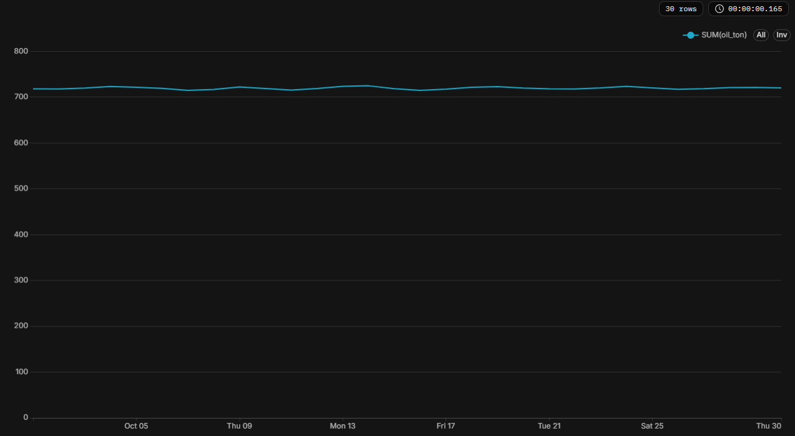

# Топ скважин
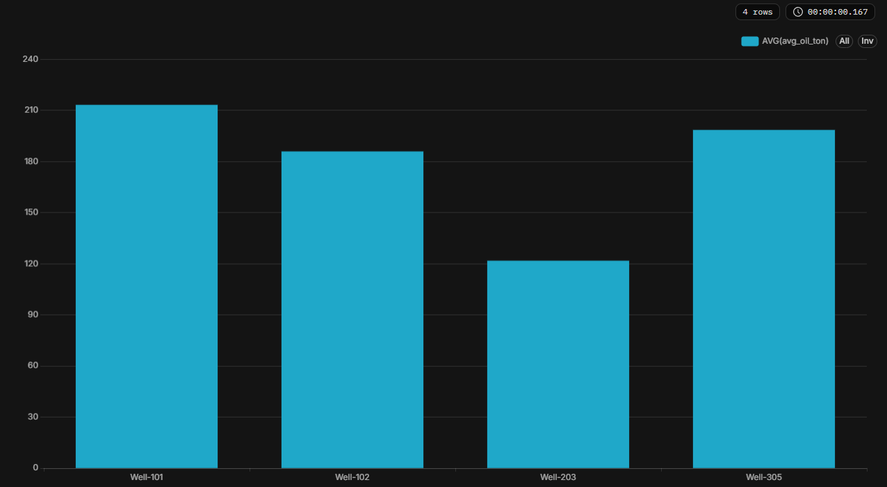

# Давление vs дебит
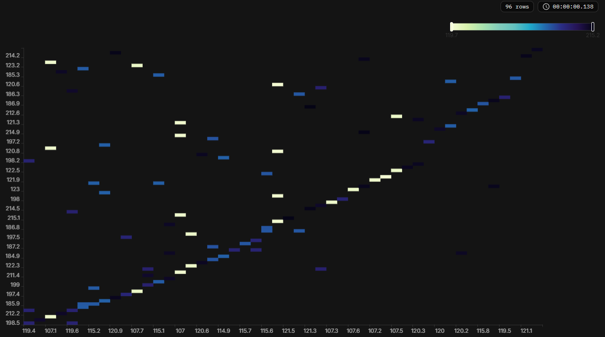

# Задание 2

# Actual vs Predicted
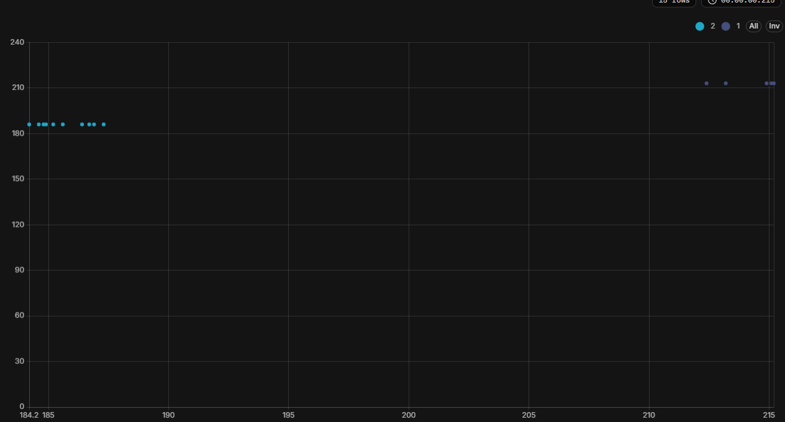

# Ошибка модели по времени
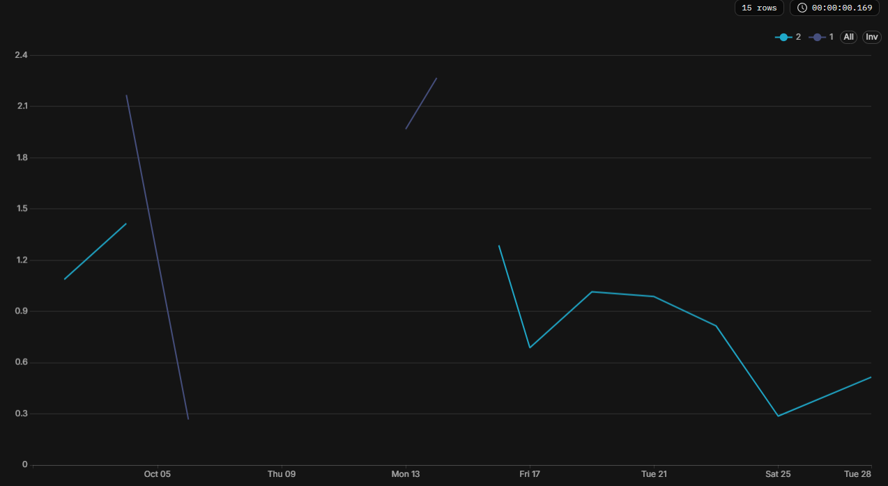

# Задание 3

# Аномалии по времени
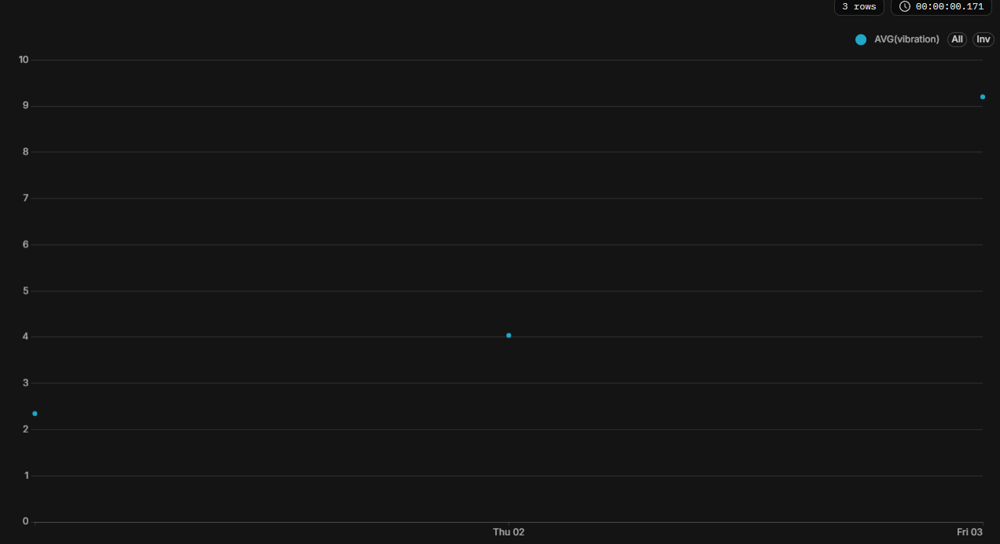

# Рост вибрации перед отказом
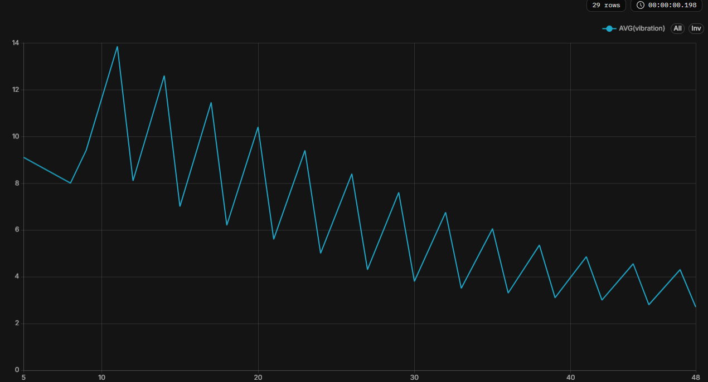

# Risk score по насосам 
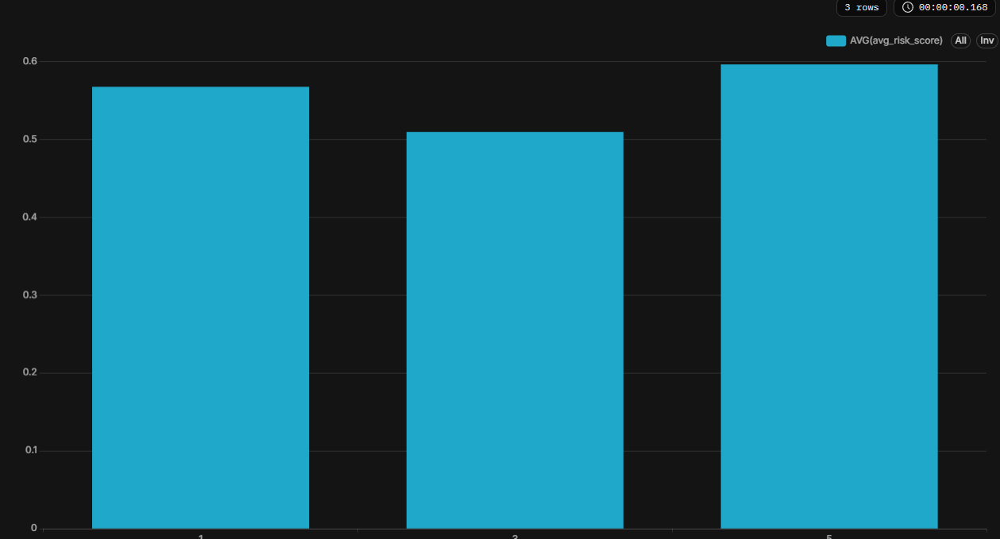

# Задание 4

# Delay vs Weather
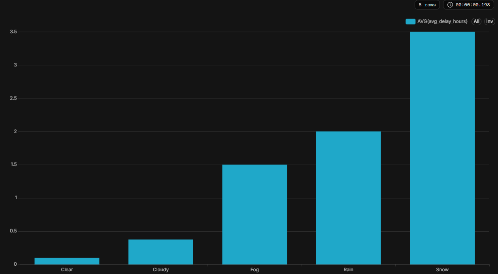

# Cost vs Distance
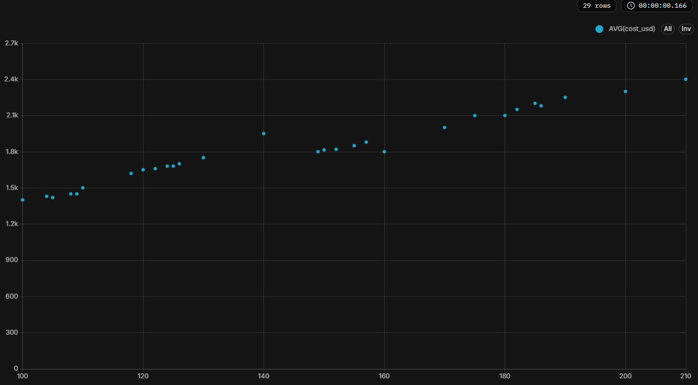

# KPI по водителям
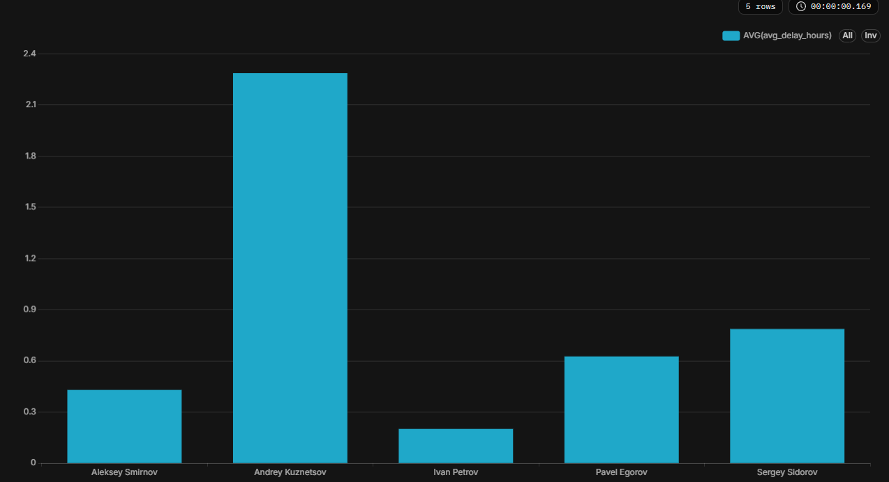